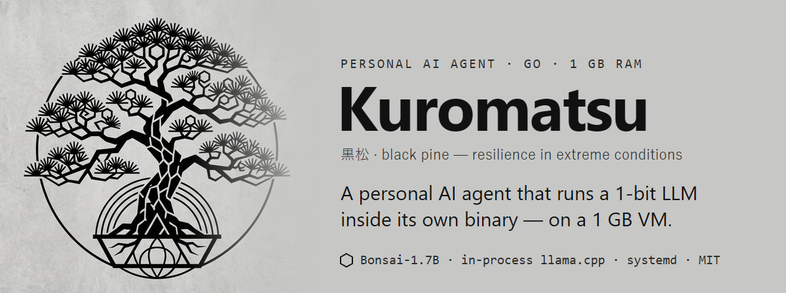
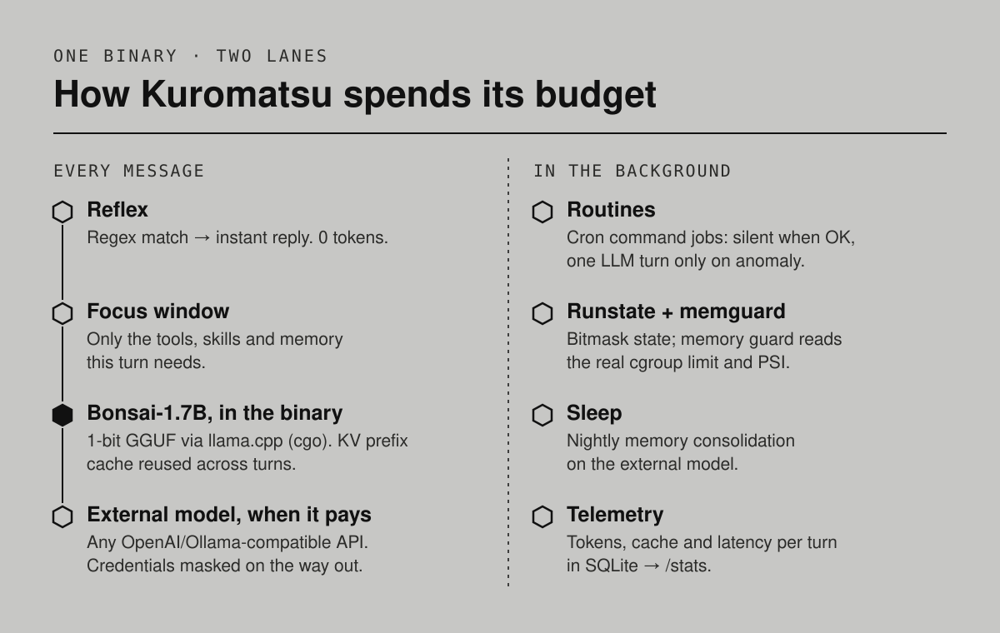

<p align="center">
  
</p>

<p align="center"><a href="#install">Install</a> · <a href="#first-run">First run</a> · <a href="#automations">Automations</a> ·
  <a href="#compatibility">Compatibility</a> · <a href="#resumo-em-português">Português</a></p>

## Running in production

The reference deployment is a Google Cloud **e2-micro** (shared vCPU, 1 GB RAM) running the
native binary under systemd — no Docker. Numbers measured on that VM:

| | |
| --- | --- |
| Memory ceiling for the whole service | `MemoryMax=900M` (systemd), model loaded |
| Native model | Bonsai-1.7B `Q1_0` GGUF, ~237 MB, in-process via llama.cpp |
| KV prefix-cache reuse on repeated turns | **93%** of prompt tokens served from cache |
| Native generation on the throttled vCPU | ~0.5 tokens/s — slow by design, so heavy language goes external |
| First reply through an external model | 1.9 s (Ollama-compatible endpoint) |
| An idle heartbeat with nothing to do | 0 tokens, 0 model calls |

## What it is

**Kuromatsu** is a personal AI agent written in Go that lives 24/7 on very small machines. It
ships a 1-bit language model *inside its own binary* (no model server, no API key), talks to you
over Telegram, WhatsApp or its own channel, runs scheduled routines, and keeps a long-term memory —
reaching for a larger external model only when the language actually needs it. Like the bonsai it is named after (黒松, *black pine*), it is grown by pruning: every token, every
megabyte and every CPU second on a burst-credit VM is treated as a budget.

## How it works

<p align="center">
  
</p>

- **Reflexes** answer pattern-matched messages instantly; **focus windows** give each turn only
  the tools, skills and memory it needs, so the prompt stays short and cacheable.
- **Native inference** runs Bonsai-1.7B through llama.cpp (cgo), keeping the stable prompt prefix
  in the KV cache; **external models** (any OpenAI- or Ollama-compatible API) take the turns that
  need more language, with credentials masked on the way out.
- **Routines** run plain commands, silent when all is fine; **runstate + memguard** protect the
  1 GB budget (real cgroup limit, PSI); **sleep** consolidates memory at night on an external
  model; **telemetry** records tokens, cache hits and latency per turn (`/stats`).

## Install

```bash
# Linux, macOS, Termux
curl -fsSL https://raw.githubusercontent.com/andre25costa-code/kuromatsu/main/scripts/install.sh | sh
# Windows (PowerShell 5.1+)
irm https://raw.githubusercontent.com/andre25costa-code/kuromatsu/main/scripts/install.ps1 | iex
```

The installer fetches the pure-Go build (external models only; for the in-process model see
[Build from source](#build-from-source)): it downloads the archive for your OS and CPU, checks its
SHA-256 against `checksums.txt`, installs the binary without root (`~/.local/bin`; Termux:
`$PREFIX/bin`; Windows: `%LOCALAPPDATA%\Kuromatsu\bin`), adds it to your user PATH and runs
`kuromatsu onboard`. If no release is published yet, it stops with `no release published yet`:
build from source instead. Which platforms are tested: [Compatibility](#compatibility).

Both installers accept `KUROMATSU_INSTALL_DIR` (install directory), `KUROMATSU_INSTALL_BASE_URL`
(where the archives are; `file://` for a local build) and `KUROMATSU_INSTALL_NO_ONBOARD=1`.
`kuromatsu update` replaces the binary with the latest release after checking its SHA-256.
`kuromatsu uninstall` removes the binary and the PATH lines and keeps your data;
`kuromatsu uninstall --purge` also deletes the data directory, **after** writing
`~/kuromatsu-backup-<date>.zip` (it refuses directories that do not look like a Kuromatsu home).
Details, PATH handling per shell and every refusal: [install guide (pt-BR)](./workspace/skills/kuromatsu-docs/references/install.md).

### Build from source

```bash
# requires Go 1.25+ and git
git clone https://github.com/andre25costa-code/kuromatsu.git
cd kuromatsu
go build -o kuromatsu ./cmd/kuromatsu   # on Windows: -o kuromatsu.exe
./kuromatsu onboard

# optional native model: Linux x86-64 with AVX2 and FMA, cmake and a C/C++ toolchain
git submodule update --init llama.cpp
make build-native-x86-64        # -> build/kuromatsu-native-linux-amd64
bash scripts/download-model.sh  # fetches Bonsai-1.7B-Q1_0.gguf and checks its SHA-256
```

Without compiling, download `kuromatsu-native_Linux_x86_64.tar.gz` from the release (listed in
the same `checksums.txt`; the installers never pick it), then fetch the model with
`bash scripts/download-model.sh`. It is linked against the glibc and
libstdc++ of Debian bookworm, so it needs that or a newer distribution ([details (pt-BR)](./workspace/skills/kuromatsu-docs/references/install.md)).

To run it as a service: [`deploy/systemd/`](./deploy/systemd) holds the unit (with `MemoryMax`)
and [`docker/`](./docker) the compose files, whose entrypoint runs `onboard --non-interactive`
on first start.

## First run

```bash
kuromatsu onboard                     # six questions, each with a default
kuromatsu agent -m "What can you do?" # talk to it from the terminal
kuromatsu gateway                     # starts the agent, its channels and the web UI
```

In a terminal, `onboard` asks for: **language**; **model provider** (OpenAI-compatible, local
Ollama, Anthropic, Gemini or OpenRouter, with a connection test that lists the models);
**Telegram** (bot token and your numeric ID) or no channel; **hardware profile**; **timezone**;
and a **permission preset** (Safe, Assistant, Advanced — none lets chats run shell commands).
`q` quits without writing anything. Running it again starts from the current config.
`onboard --non-interactive` asks nothing (scripts, Docker, no terminal): built-in defaults plus,
on a new config, the detected hardware profile; no provider or channel. To add a model later: `kuromatsu model add -b <api-base> -k <your-key>`.

### Web UI

The gateway serves a configuration page at `http://localhost:18790/ui/`: assistant files,
models, channels, permissions, skills, automations, heartbeat and status (in pt-BR, usable on a
phone). It answers **only on loopback** by default. Treat the token like a password: whoever has
it can turn on command execution. From another machine, use an SSH tunnel:

```bash
kuromatsu ui token                          # prints the access token (created by onboard)
kuromatsu ui open                           # prints the address
ssh -L 18790:localhost:18790 <your-host>    # from another machine, then open the same URL
```

`webui.allow_remote` exposes the page over plain HTTP and is discouraged; prefer the tunnel.
Security model, sessions and lockout: [web UI guide (pt-BR)](./workspace/skills/kuromatsu-docs/references/webui.md).

### Hardware profiles

On a new config, `onboard` reads RAM (the smaller of total RAM and the cgroup limit) and CPUs and
writes a profile as plain config values (native context, threads, memguard, sub-turns, heartbeat):

| Profile | When |
|---|---|
| Ultra-Light | RAM < 768 MiB |
| Light | RAM < 2 GiB (equals the built-in defaults) |
| Balanced | RAM < 8 GiB, or fewer than 4 CPUs |
| Performance | 8 GiB or more and at least 4 CPUs |

An existing config only changes with `kuromatsu onboard --profile <ultra-light|light|balanced|performance|auto>`
or a choice in the wizard. `kuromatsu status` shows the hardware, the matching profile and
whether the CPU has what the native build needs: without AVX2/FMA the native model is refused
rather than loaded (see [Limits](#limits)).

## Configuration

Configuration lives in `~/.kuromatsu/config.json`; secrets go in `.security.yml`. A minimal
setup with an external model first, the native model as fallback, and Telegram for one user:

```json
{
  "agents": { "defaults": {
    "model_name": "cloud", "model_fallbacks": ["bonsai-local"], "focus": { "enabled": true } } },
  "model_list": [
    { "model_name": "cloud", "provider": "ollama", "model": "<model>", "api_base": "https://<your-endpoint>/v1" },
    { "model_name": "bonsai-local", "provider": "native", "model": "Bonsai-1.7B-Q1_0", "tool_schema_transform": "compact" }
  ],
  "channel_list": {
    "telegram": { "enabled": true, "type": "telegram", "allow_from": ["<your-telegram-user-id>"] }
  }
}
```

The full reference — every key, channel, tool and schedule — is the `kuromatsu-docs` skill the
agent itself reads: [`workspace/skills/kuromatsu-docs`](./workspace/skills/kuromatsu-docs/SKILL.md) (pt-BR).

### Security

Channels are **Telegram**, **WhatsApp** and the built-in **Pico**. Each is fail-closed: an empty
`allow_from` **rejects everyone** (the first dropped message logs the sender ID so you can copy
it). `"*"` opens the bot **to anyone**, so use it only on purpose; even then, changing things
from chat (`/config set`, `/cron` pause/resume/run/new) needs your numeric ID in the list too,
as in `["*", "<your-telegram-user-id>"]`. Pico uses `"*"` because its token gates access.

Shell commands requested from a chat are off by default (`tools.exec.allow_remote`). The exec
guard is a best-effort pattern filter, **not a sandbox**; child-process isolation is separate
and off by default: [isolation (pt-BR)](./workspace/skills/kuromatsu-docs/references/isolation.md).

## Automations

```text
/cron templates                         list the ready-made automations
/cron new lembrete texto="drink water" todo_dia=15:00
/cron list | pause <id> | resume <id> | run <id> | history <id>
/config                                 summary of the config, no secrets
/config set heartbeat.interval 30       only a short list of safe keys
```

Four templates: `lembrete` (reminder), `resumo-diario` (daily summary), `monitorar-pagina`
(watch a page for a condition) and `pesquisa-diaria` (daily research). Anyone the channel accepts
can read; changing needs the sender's numeric ID in `allow_from`. Security keys never change from chat.

Other ways to schedule: ask the agent in plain language, use the **Automations** screen of the
web UI, run `kuromatsu cron add --command '…' --quiet` for deterministic routines that speak
only on anomaly, or write `HEARTBEAT.md` for periodic tasks that need judgment. Every job keeps
its real status and run history, and is switched off after repeated failures, with a notice.
How-to and re-enabling: [automations guide (pt-BR)](./workspace/skills/kuromatsu-docs/references/automations.md).

### Loop protections

Under `agents.defaults`: `user_turn_max_minutes` (default 30, `0` = off) caps a whole user turn,
also on the CLI and the slow native model; `max_repeated_tool_calls` (default 3) ends a turn
that keeps repeating the same call with the same result; `subturn.max_concurrent_global`
(default 8 per depth level) caps concurrent sub-turns. Each exec call has its own timeout
(`tools.exec.timeout_seconds`, default 60). The turn cap and sub-turn pools are read at
startup; restart after changing them.

## Compatibility

**Tested**: installed with the installer from a local archive, then `onboard --non-interactive` and
`version`, on a real machine. **Cross-built, not run**: the release builds it; nobody has run it yet.

| Platform | Release file | Status |
|---|---|---|
| Linux x86-64 | `kuromatsu_Linux_x86_64.tar.gz` | **Tested** (Debian) |
| Windows x86-64 | `kuromatsu_Windows_x86_64.zip` | **Tested** (Windows 11, PowerShell 5.1) |
| Linux x86-64, native model (AVX2+FMA) | `kuromatsu-native_Linux_x86_64.tar.gz` | Cross-built, not run |
| Linux arm64 | `kuromatsu_Linux_arm64.tar.gz` | Cross-built, not run |
| macOS (Apple silicon, Intel) | `kuromatsu_Darwin_arm64.tar.gz`, `kuromatsu_Darwin_x86_64.tar.gz` | Cross-built, not run |
| Android / Termux (arm64) | `kuromatsu_Android_arm64.tar.gz` | Cross-built, not run |
| Docker image (linux/amd64, arm64, riscv64) | `ghcr.io/andre25costa-code/kuromatsu` (and Docker Hub when configured) | Cross-built, not run |
| Windows arm64; Linux armv6, armv7, riscv64, loong64, s390x; FreeBSD; NetBSD; `.deb`/`.rpm` | `kuromatsu_<Os>_<Arch>.tar.gz` (Windows: `.zip`); `kuromatsu_<arch>.deb`, `.rpm` | Cross-built, not run |

On Termux, use the Android archive, not the Linux arm64 one. macOS binaries are not notarized unless
the release is signed: a browser download may be blocked by Gatekeeper, the `curl` install is not.

## Limits

- Native generation is slow on shared CPUs; Kuromatsu is built to need the native model rarely,
  not to make it fast.
- The native build targets x86-64 with AVX2 and FMA; other platforms use the pure-Go build with
  external models. On a CPU without them, Kuromatsu refuses the native model, but llama.cpp's own
  startup code may still crash first: use the pure-Go release there.
- The web UI answers only on loopback by default; there is no TLS.
- macOS, Termux and the other cross-built targets have not been run yet ([Compatibility](#compatibility)).
- Memory search is lexical (SQLite FTS5); there is no semantic (embeddings) search yet.

## Resumo em português

O **Kuromatsu** é um agente pessoal de IA em Go para máquinas pequenas (a referência é uma VM
e2-micro com 1 GB de RAM), com um modelo de 1 bit (Bonsai-1.7B) **dentro do próprio binário**.
Instala em um comando (`install.sh` no Linux, macOS e Termux; `install.ps1` no Windows), sem
root e com checksum, e em seguida roda o `kuromatsu onboard`, um assistente de seis perguntas
(idioma, modelo, Telegram, perfil de hardware, fuso, permissões). A página web local fica em
`http://localhost:18790/ui/`, só por loopback, com o token de `kuromatsu ui token`; de outra
máquina, use um túnel SSH. Automações por `/cron` no chat, pela tela Automações ou pelo
`HEARTBEAT.md`; alterar pelo chat exige o seu ID numérico no `allow_from`. Os perfis Ultra-Light,
Light, Balanced e Performance gravam valores explícitos no config. Documentação completa em
pt-BR: skill [`kuromatsu-docs`](./workspace/skills/kuromatsu-docs/SKILL.md).

## Credits

Kuromatsu started as a fork of [PicoClaw](https://github.com/sipeed/picoclaw) (MIT). Native
inference uses [llama.cpp](https://github.com/ggml-org/llama.cpp) through the
[PrismML-Eng fork](https://github.com/PrismML-Eng/llama.cpp) and the
[Bonsai-1.7B](https://huggingface.co/prism-ml/Bonsai-1.7B-gguf) model by prism-ml.

## License

[MIT](./LICENSE).
